<a href="./README.md">English</a> · <b>Español</b>

  

  <a href="https://www.luistrinidad.dev/">luistrinidad.dev</a> &nbsp;·&nbsp;
  <a href="https://www.linkedin.com/in/luis-de-jes%C3%BAs-trinidad-garcia-1237a2299/">LinkedIn</a> &nbsp;·&nbsp;
  <a href="https://www.npmjs.com/package/trazosuite">npm</a> &nbsp;·&nbsp;
  <a href="https://www.instagram.com/luis.trinidad_g/">Instagram</a>

 

Construyo ERPs para empresas de tratamiento de aguas, distribución, manufactura, bienes raíces y agroindustria. Casi todo lo que hago es código privado de clientes, así que aquí muestro las partes de las que sí puedo hablar.

Trabajo en todo el stack: base de datos, API, web, móvil, CI/CD y nube.

 

## Proyectos destacados

Los nombres de los clientes se omiten a propósito.

  

<b>Detalles</b>

 

- **Plano de control.** API de control, super-admin y base de datos de control. El provisioning ejecuta `CREATE DATABASE` y `prisma migrate deploy` para cada cliente, con credenciales cifradas, impersonación, logs de auditoría y logs de Cloud Run en vivo.
- **Variant packs.** `compras:v2` reemplaza 12 módulos para un solo cliente en runtime, con guards globales y recarga de configuración por eventos.
- **IA documental.** NestJS se conecta a un servicio en Python/FastAPI que usa Gemini con salidas estructuradas (OpenAI y Kimi como motores alternativos), lee códigos QR, consulta registros de gobierno en paralelo, valida de forma cruzada, detecta fraude, hace fuzzy matching y transmite el progreso por SSE. El consumo de tokens se mide por cliente.
- **Scraper del SAT con humano en el ciclo.** Puppeteer abre el portal del SAT, captura el captcha y lo manda por Socket.IO para que el usuario lo resuelva en vivo.
- **PWA de almacén offline-first.** Cola en IndexedDB con llaves de idempotencia `x-action-id`, fotos y firmas guardadas como blobs con deduplicación, estado de conflicto visible y caché de Workbox que separa el stream RSC del HTML.
- **Módulo de RH.** Contratos desde plantillas DOCX, nómina semanal, asistencia masiva, IMSS y gafetes con QR y página pública protegida por token.
- **Infraestructura.** Imágenes Docker multi-stage (con Chromium para Puppeteer), Cloud Run y Cloud Build, signed URLs de GCS y CI con 3 jobs de tests ajustados para no quedarse sin memoria.

 

  

<b>Detalles</b>

 

- **Modelo.** MobileFaceNet (ONNX) corriendo en el teléfono. Detección con ML Kit, 478 landmarks de MediaPipe reducidos a 5 anclas de ArcFace, alineación Umeyama con SVD 2×2, embeddings de 128 dimensiones y match por coseno top-1 con umbral y margen top1−top2.
- **Un núcleo, tres entornos.** Teléfono, worklets de VisionCamera y el navegador del admin (onnxruntime-web). Un golden test ejecuta el modelo real.
- **Prueba de vida.** Eye Aspect Ratio y una máquina de estados de parpadeo (al menos un parpadeo en 3.5 s). Si no hay datos de los ojos, la prueba falla.
- **Offline.** Drizzle con dos dialectos (77 tablas de Postgres espejadas en SQLite), outbox con flush programado, sincronización por dominio y colas de fotos.
- **Aislamiento por cliente.** RLS de Postgres con un rol dedicado y `SET LOCAL app.farm_id` en cada transacción.
- **Dominio.** Nómina agrícola semanal con cierre bloqueado, importador de nómina desde Excel, kiosco de báscula para remolques, proyecciones de ciclos de siembra con Turf.js y consentimientos biométricos.
- **Publicación.** Expo 55 con la nueva arquitectura de React Native, EAS Build, app Android publicada, ~190 archivos de tests y Storybook.

 

  

 

## Otros sistemas en producción

| Sistema | Notas |
|---|---|
| **ERP de distribución**  ~283k LOC · 174 tablas | Facturación electrónica: CFDI, complementos de pago, REP para facturas PPD y notas de crédito relacionadas. POS con turnos, conteo de efectivo y bloqueo de caja. PWA para choferes con MapLibre, rutas OSRM, firmas y cola de subidas offline. |
| **CRM inmobiliario**  ~177k LOC | Chat con Socket.IO y sockets protegidos con JWT, webhooks de Meta Lead Ads, Gemini convirtiendo brochures PDF a JSON, portal de residentes PWA y auditorías de seguridad por fases. |
| **SaaS de manufactura**  ~205k LOC | Arreglé 213 specs de tests que fallaban, monté el pipeline de CI, hice el RBAC, las firmas estampadas en PDFs y un dashboard financiero de OC contra CFDI. |
| **ERP institucional** | Integración con Puppeteer al registro nacional de CURP, RH con movimientos IMSS, migración del frontend a TypeScript y un portal de proveedores hecho por mí. |
| **Operación de un ecoparque** | Pulseras NFC cashless, POS por zonas con cortes de caja, recorridos vehiculares y migración de MongoDB a PostgreSQL. |

 

## Proyectos personales

| Proyecto | Stack | Notas |
|---|---|---|
| [**BichoFit**](https://github.com/Luis-Trinidad/BichoFit) · [en vivo](https://fit.luistrinidad.dev) | Laravel 13, Inertia 3, Svelte 5 | Lee los tickets de básculas de bioimpedancia con OCR. 1,324 ejercicios, 81 tests. |
| **BichoFinance** | NestJS 11, Prisma 7, React 19 | Importa estados de cuenta en PDF, detecta el banco, parsea y deduplica movimientos. 2FA obligatorio, AES-256. |

 

## Multitenancy

He llevado a producción los tres enfoques comunes:

| | Base de datos por cliente | Schema por cliente | Row-Level Security |
|---|---|---|---|
| **Cómo** | `CREATE DATABASE` + migraciones por cliente, credenciales cifradas | Schemas `t_<id>` / `r_<id>` en una sola base | Rol dedicado de Postgres + `SET LOCAL` con el id del cliente en cada transacción |
| **Por qué** | El aislamiento más fuerte, módulos distintos por cliente | Punto medio entre costo y separación | El más barato, el aislamiento lo garantiza Postgres |
| **Dónde** | Plataforma ERP (NestJS, Prisma) | Plataforma SaaS (Drizzle) | Kiosco de reconocimiento facial (PostgreSQL 16) |

 

## Stack

<table>
  <tr>
    <td width="130"><b>Lenguajes</b></td>
    <td></td>
  </tr>
  <tr>
    <td><b>Frontend / móvil</b></td>
    <td></td>
  </tr>
  <tr>
    <td><b>Backend</b></td>
    <td></td>
  </tr>
  <tr>
    <td><b>Datos</b></td>
    <td></td>
  </tr>
  <tr>
    <td><b>Nube / DevOps</b></td>
    <td></td>
  </tr>
</table>

<b>Todo lo demás</b>

 

- **IA / ML:** Gemini, OpenAI SDK, servidores MCP, ONNX Runtime, MobileFaceNet, MediaPipe, ML Kit, Apple Vision, Tesseract, rapidfuzz
- **Tiempo real y colas:** Socket.IO, SSE, Laravel Reverb, Yjs/Hocuspocus, BullMQ, pg-boss, patrón outbox
- **Documentos:** Puppeteer, pdf-lib, PDFKit, docxtemplater, exceljs, OnlyOffice, Ghostscript
- **Seguridad:** JWT con secretos por audiencia, RBAC, 2FA TOTP, AES-256, argon2, llaves de idempotencia, RLS de Postgres
- **Integraciones:** Stripe, WhatsApp Cloud API, Meta Lead Ads, FacturAPI, signed URLs de GCS, MapLibre + OSRM
- **Infraestructura:** Cloud Run, Cloud Build, Dokploy, Firebase Hosting, Caddy, EAS Build, Sentry, Turborepo

 

  

Mazatlán, México

