<b>English</b> · <a href="./README.es.md">Español</a>

  

  <a href="https://www.luistrinidad.dev/">luistrinidad.dev</a> &nbsp;·&nbsp;
  <a href="https://www.linkedin.com/in/luis-de-jes%C3%BAs-trinidad-garcia-1237a2299/">LinkedIn</a> &nbsp;·&nbsp;
  <a href="https://www.npmjs.com/package/trazosuite">npm</a> &nbsp;·&nbsp;
  <a href="https://www.instagram.com/luis.trinidad_g/">Instagram</a>

 

I build ERPs for companies in water treatment, distribution, manufacturing, real estate and agriculture. Most of what I work on is private client code, so this page shows the parts I can talk about.

I work across the whole stack: database, API, web, mobile, CI/CD and cloud.

 

## Featured work

Client names are left out on purpose.

  

<b>Details</b>

 

- **Control plane.** Control API, super-admin and control DB. Provisioning runs `CREATE DATABASE` and `prisma migrate deploy` for each tenant, with encrypted credentials, impersonation, audit logs and live Cloud Run logs.
- **Variant packs.** `compras:v2` replaces 12 modules for a single tenant at runtime, with global guards and event-driven config reload.
- **Document AI.** NestJS talks to a Python/FastAPI service that uses Gemini structured outputs (OpenAI and Kimi as alternative engines), reads QR codes, checks government registries in parallel, cross-validates, flags fraud, fuzzy-matches and streams progress over SSE. Token usage is tracked per tenant.
- **SAT scraper with a human in the loop.** Puppeteer opens the tax portal, grabs the captcha and sends it over Socket.IO so the user can solve it live.
- **Offline-first warehouse PWA.** IndexedDB queue with `x-action-id` idempotency keys, photos and signatures stored as blobs with dedupe, a visible conflict state, and Workbox caching that keeps the RSC stream apart from HTML.
- **HR module.** DOCX contracts, weekly payroll, bulk attendance, IMSS, QR ID badges with token-gated public pages.
- **Infra.** Multi-stage Docker images (Chromium for Puppeteer), Cloud Run and Cloud Build, GCS signed URLs, CI with 3 test jobs tuned to avoid running out of memory.

 

  

<b>Details</b>

 

- **Model.** MobileFaceNet (ONNX) running on the phone. ML Kit detection, 478 MediaPipe landmarks reduced to 5 ArcFace anchors, Umeyama alignment with a 2×2 SVD, 128-d embeddings, cosine top-1 with a threshold and a top1−top2 margin.
- **One core, three runtimes.** Phone, VisionCamera worklets and the admin's browser (onnxruntime-web). A golden test runs the real model.
- **Liveness.** Eye Aspect Ratio and a blink state machine (at least one blink in 3.5 s). If there is no eye data, the check fails.
- **Offline.** Drizzle with two dialects (77 Postgres tables mirrored in SQLite), an outbox with a flush scheduler, per-domain pull sync, photo queues.
- **Tenant isolation.** Postgres RLS with a dedicated role and `SET LOCAL app.farm_id` per transaction.
- **Domain.** Weekly farm payroll with locked settlement, an Excel payroll importer, a trailer weighing kiosk, crop-cycle projections with Turf.js, biometric consent.
- **Shipping.** Expo 55 on the new React Native architecture, EAS Build, published Android app, ~190 test files, Storybook.

 

  

 

## Other systems in production

| System | Notes |
|---|---|
| **Distribution ERP**  ~283k LOC · 174 tables | Mexican e-invoicing: CFDI, payment complements, REP for PPD invoices, related credit notes. POS with shifts, cash counts and drawer locks. Driver PWA with MapLibre, OSRM routing, signatures and an offline upload queue. |
| **Real-estate CRM**  ~177k LOC | Socket.IO chat with JWT-guarded sockets, Meta Lead Ads webhooks, Gemini reading PDF brochures into JSON, a resident portal PWA, and security audits done in phases. |
| **Manufacturing SaaS**  ~205k LOC | Fixed 213 failing test specs, set up the CI pipeline, built RBAC, signatures stamped into PDFs and a PO vs. CFDI financial dashboard. |
| **Institutional ERP** | Puppeteer integration with the national ID registry, HR with IMSS movements, frontend migrated to TypeScript, supplier portal built on my own. |
| **Eco-park operations** | NFC cashless wristbands, POS by zone with cash cuts, vehicle tours, migration from MongoDB to PostgreSQL. |

 

## Side projects

| Project | Stack | Notes |
|---|---|---|
| [**BichoFit**](https://github.com/Luis-Trinidad/BichoFit) · [live](https://fit.luistrinidad.dev) | Laravel 13, Inertia 3, Svelte 5 | Reads bioimpedance scale tickets with OCR. 1,324 exercises, 81 tests. |
| **BichoFinance** | NestJS 11, Prisma 7, React 19 | Imports bank statement PDFs, detects the bank, parses and dedupes transactions. Mandatory 2FA, AES-256. |

 

## Multi-tenancy

I've shipped all three common approaches:

| | Database per tenant | Schema per tenant | Row-Level Security |
|---|---|---|---|
| **How** | `CREATE DATABASE` + migrations per tenant, encrypted credentials | `t_<id>` / `r_<id>` schemas in one database | Dedicated Postgres role + `SET LOCAL` tenant id per transaction |
| **Why** | Strongest isolation, per-tenant module variants | Middle ground on cost and separation | Cheapest, isolation enforced by Postgres |
| **Where** | ERP platform (NestJS, Prisma) | SaaS platform (Drizzle) | Face recognition kiosk (PostgreSQL 16) |

 

## Stack

<table>
  <tr>
    <td width="130"><b>Languages</b></td>
    <td></td>
  </tr>
  <tr>
    <td><b>Frontend / mobile</b></td>
    <td></td>
  </tr>
  <tr>
    <td><b>Backend</b></td>
    <td></td>
  </tr>
  <tr>
    <td><b>Data</b></td>
    <td></td>
  </tr>
  <tr>
    <td><b>Cloud / DevOps</b></td>
    <td></td>
  </tr>
</table>

<b>Everything else</b>

 

- **AI / ML:** Gemini, OpenAI SDK, MCP servers, ONNX Runtime, MobileFaceNet, MediaPipe, ML Kit, Apple Vision, Tesseract, rapidfuzz
- **Realtime and queues:** Socket.IO, SSE, Laravel Reverb, Yjs/Hocuspocus, BullMQ, pg-boss, outbox pattern
- **Documents:** Puppeteer, pdf-lib, PDFKit, docxtemplater, exceljs, OnlyOffice, Ghostscript
- **Security:** JWT with per-audience secrets, RBAC, TOTP 2FA, AES-256, argon2, idempotency keys, Postgres RLS
- **Integrations:** Stripe, WhatsApp Cloud API, Meta Lead Ads, FacturAPI, GCS signed URLs, MapLibre + OSRM
- **Infra:** Cloud Run, Cloud Build, Dokploy, Firebase Hosting, Caddy, EAS Build, Sentry, Turborepo

 

  

Mazatlán, México

