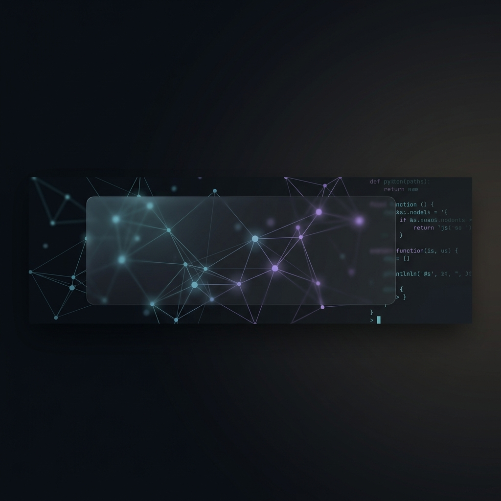

<p align="center">
  
</p>

<div align="center">

[](https://git.io/typing-svg)

[](https://git.io/typing-svg)

<br/>

[](https://www.linkedin.com/in/luis-de-jes%C3%BAs-trinidad-garcia-1237a2299/)
[](https://github.com/Luis-Trinidad)
[](https://www.instagram.com/luis.trinidad_g/)

</div>

<br/>

## `> whoami`

Software Engineer at **Trazolab** based in Mazatlán, México. I design and build **enterprise-grade systems** — from monorepo architectures to cloud-deployed platforms serving real businesses.

My day-to-day involves shipping **ERP systems, logistics platforms, and SaaS products** used by companies and government organizations. I own the full stack: database design, API architecture, frontend interfaces, PWAs, CI/CD pipelines, and cloud infrastructure.

<br/>

## 🏗️ What I Build

> Production systems that run real operations — not just side projects.

<table>
  <tr>
    <td width="50%">
      <h3>🏢 Enterprise Resource Planning</h3>
      <p>Full ERP systems for manufacturing & logistics companies. Modules include <strong>HR, Procurement, Inventory, Finance, and Document Automation</strong>. Monorepo architecture with shared packages.</p>
      <p><code>NestJS</code> <code>Next.js</code> <code>Prisma</code> <code>PostgreSQL</code> <code>pnpm Workspaces</code></p>
    </td>
    <td width="50%">
      <h3>🎯 SaaS Platforms</h3>
      <p>Multi-tenant appointment booking system with <strong>demo mode, domain detection, and white-label capabilities</strong>. Full CRM portal + client-facing scheduling.</p>
      <p><code>NestJS</code> <code>Next.js</code> <code>Vite</code> <code>PostgreSQL</code> <code>Dokploy</code></p>
    </td>
  </tr>
  <tr>
    <td width="50%">
      <h3>🚛 Logistics & Field Operations</h3>
      <p>PWA for delivery drivers with <strong>real-time tracking, signature capture, camera integration</strong>, and offline-capable workflows deployed via Docker.</p>
      <p><code>Next.js PWA</code> <code>NestJS</code> <code>Google Maps</code> <code>Cloud Run</code></p>
    </td>
    <td width="50%">
      <h3>🔒 Security Tooling</h3>
      <p>Client-side web security audit tool. <strong>Pure TypeScript, zero backend</strong>, 80+ unit tests, modular scanner architecture. From 3,200-line monolith to clean 68KB bundle.</p>
      <p><code>TypeScript</code> <code>Vite</code> <code>Vitest</code> <code>Zero Dependencies</code></p>
    </td>
  </tr>
</table>

<br/>

## ⚡ Tech Stack

<table>
  <tr>
    <td align="center" width="140"><strong>Frontend</strong></td>
    <td>
      
      
      
      
      
      
      
      
    </td>
  </tr>
  <tr>
    <td align="center"><strong>Backend</strong></td>
    <td>
      
      
      
      
      
    </td>
  </tr>
  <tr>
    <td align="center"><strong>Database</strong></td>
    <td>
      
      
      
      
    </td>
  </tr>
  <tr>
    <td align="center"><strong>Cloud & DevOps</strong></td>
    <td>
      
      
      
      
      
      
    </td>
  </tr>
</table>

<br/>

## 🧠 Architecture & Patterns

```
┌─────────────────────────────────────────────────────────┐
│                    MONOREPO (pnpm)                       │
├─────────────┬─────────────┬─────────────┬───────────────┤
│  apps/api   │  apps/admin │  apps/pwa   │  apps/portal  │
│  (NestJS)   │  (Next.js)  │  (Next.js)  │  (Vite/Vue)   │
├─────────────┴─────────────┴─────────────┴───────────────┤
│              packages/shared (types, utils)              │
├─────────────────────────────────────────────────────────┤
│          Prisma ORM  →  PostgreSQL / Cloud SQL          │
├─────────────────────────────────────────────────────────┤
│     Docker → Google Cloud Run / Dokploy / VPS           │
└─────────────────────────────────────────────────────────┘
```

<br/>

## 📊 GitHub Stats

<div align="center">

[](https://git.io/streak-stats)

[](https://github.com/anuraghazra/github-readme-stats)

</div>

<br/>

## 📈 Activity

[](https://github.com/ashutosh00710/github-readme-activity-graph)

---

<div align="center">
  
  
  <br/><br/>
  
  <sub><b>Building enterprise software from Mazatlán, MX 🌊</b></sub>
</div>
